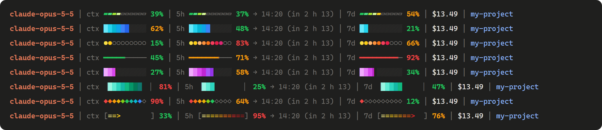
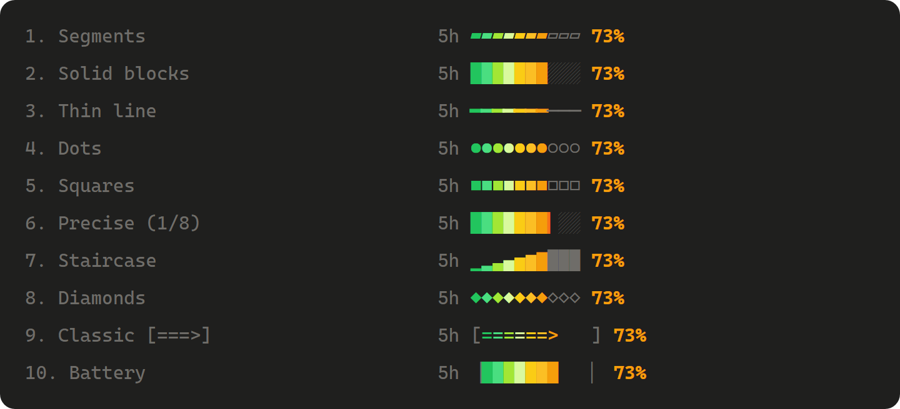
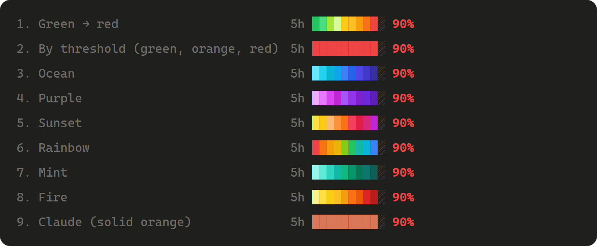

# Claude status bar

A status bar for the **Code tab of Claude Desktop**, shown right above the prompt, like the
terminal statusline. *[Version française plus bas.](#français)*



- model in use;
- context window fill;
- 5-hour quota: percentage, reset time and time left (updated every minute);
- 7-day quota;
- session cost;
- working folder.

The percentage is green, orange from 50 %, red from 80 %. Context and quotas show up after
Claude's first answer.

## Install

In a Claude Code session (Claude Desktop Code tab, or terminal), type:

```
/plugin install status-bar --marketplace skisofrene2001/claude-status-bar
```

Answer `y` to add the marketplace, then pick the **user** scope so it is on in all your sessions.
Update later with `/plugin update status-bar`.

## Choose your style and colors

Each person picks the look of the bars; the choice is kept from one session to the next.

`/bar-style` lists the 10 styles, `/bar-style 3` (or `/bar-style "thin line"`) picks one:



`/bar-color` lists the 9 palettes, `/bar-color 3` (or `/bar-color ocean`) picks one:



Every style works with every palette.

## Français

Bandeau d'état pour l'onglet Code de Claude Desktop, au-dessus de la zone de saisie : modèle,
contexte, quota de 5 h (pourcentage, heure de remise à zéro, temps restant), quota de 7 jours,
coût et dossier.

Installation, dans une session Claude :

```
/plugin install status-bar --marketplace skisofrene2001/claude-status-bar
```

Les commandes existent aussi en français, et le bandeau suit alors la langue de la commande
(« 7j », « dans 2 h 13 ») :

- `/barre-style` : liste les 10 styles ; `/barre-style 3` en choisit un ;
- `/barre-couleur` : liste les 9 palettes ; `/barre-couleur 3` en choisit une.

Styles : Segments, Blocs pleins, Ligne fine, Points, Carrés, Précise au 1/8, Escalier,
Losanges, Classique `[===>]`, Batterie.
Palettes : Vert → rouge, Selon le seuil, Océan, Violet, Coucher de soleil, Arc-en-ciel,
Menthe, Feu, Claude (orange uni).

## Regenerating the images

`npx -y tsx scripts/previews.ts` writes `docs/*.svg` from the real bar code; the README shows
their PNG renders.
